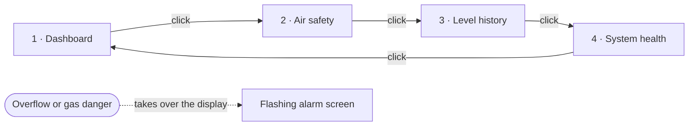
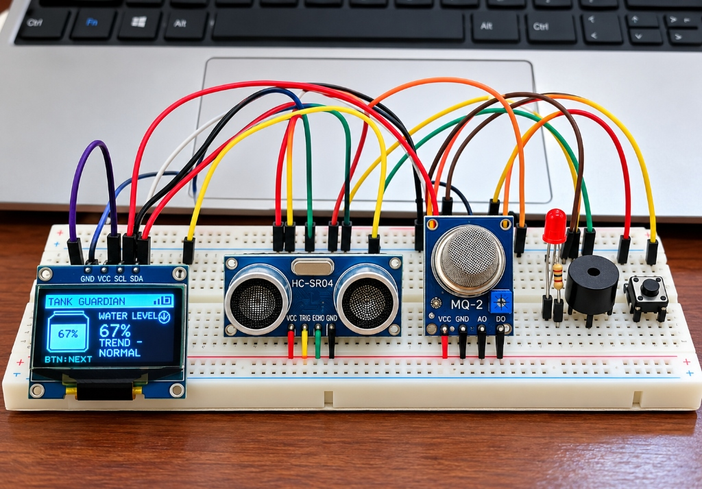
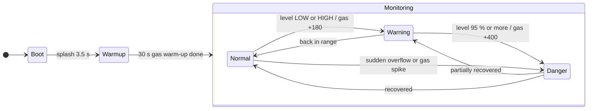
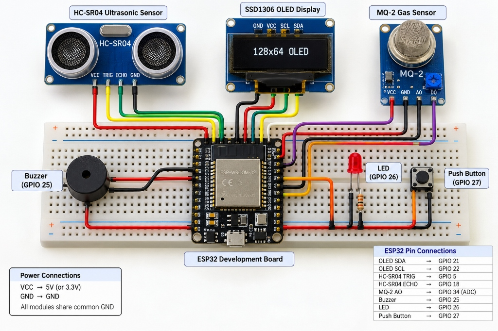

<p align="center">
  
</p>

<p align="center">
  <a href="https://www.espressif.com/"></a>
  <a href="https://www.arduino.cc/"></a>
  <a href="https://github.com/olikraus/u8g2"></a>
  <a href="LICENSE"></a>
</p>

<p align="center">
  <b>Level</b> &nbsp;·&nbsp; <b>Air</b> &nbsp;·&nbsp; <b>Alarm</b><br/>
  One ESP32 watches a liquid tank with an ultrasonic sensor and a gas sensor,<br/>
  draws live graphs on a tiny OLED, and sounds a two-tier alarm when something goes wrong.
</p>

<p align="center">
  <a href="#live-demo">Live demo</a> ·
  <a href="#how-it-works">How it works</a> ·
  <a href="#the-alert-ladder">Alerts</a> ·
  <a href="#air-safety-engine">Air safety</a> ·
  <a href="#wiring">Wiring</a> ·
  <a href="#quick-start">Quick start</a> ·
  <a href="#calibration">Calibration</a>
</p>

<p align="center"></p>

## What it does

| 🌊 **Level** | ☣️ **Air** | 🚨 **Alarm** |
|:--|:--|:--|
| An HC-SR04 looks down into the tank. Five echoes are averaged per reading and turned into a percentage, with a rising / falling / stable trend. | An MQ-series sensor is read 12× per sample, smoothed, and compared with a **self-adjusting baseline** rather than a fixed number. | Two tiers. **Warning** blinks slowly and chirps at 900 Hz. **Danger** blinks fast, chirps at 1600 Hz and takes over the whole display. |

<p align="center"></p>

## Live demo

Everything on the OLED, plus what the LED and buzzer do at the same moment. The animation loops forever. Watch the water rise, the status flip to **HIGH**, the LED start blinking, and finally the full-screen overflow alarm.

<p align="center">
  
</p>

> [!NOTE]
> This is a close re-creation drawn from the firmware's screen logic, thresholds and timings, not a screen recording. A few elements are nudged for legibility, and the warm-up is sped up (the real one takes 30 s).

Press the single button to cycle the four main screens:



<p align="center"></p>

## The real thing

<p align="center">
  
  <br/>
  <sub>The breadboard prototype: OLED · HC-SR04 · MQ-2 · LED · passive buzzer · push button</sub>
</p>

<p align="center"></p>

## How it works

Sense, think, act, on a loop. Sensors are sampled every 500 ms; the screen refreshes every 100 ms.

<p align="center">
  
</p>

<p align="center"></p>

## The alert ladder

Water level decides what you see and hear. Watch the marker slide through every zone.

<p align="center">
  
</p>

<details>
<summary><b>See the same logic as a state diagram</b></summary>



**Outputs per state**

| State | LED | Buzzer | Display |
|---|---|---|---|
| Normal | solid on | silent | your selected screen |
| Warning | blink 0.7 s | 900 Hz chirp every ~2.2 s | your selected screen |
| Danger | blink 0.3 s | 1600 Hz chirp every ~1.0 s | flashing full-screen alarm |

Danger from *either* the water or the gas sensor triggers the alarm screen.

</details>

<p align="center"></p>

## Air-safety engine

A fixed gas threshold drifts out of tune with temperature, humidity and sensor age. So the firmware **learns what normal looks like** and reacts to a *rise above it*. Everything in the chart below was produced by running the firmware's own filter and threshold rules on a simulated slow drift followed by a gas event.

<p align="center">
  
</p>

<details>
<summary><b>The rules, exactly as implemented</b></summary>

| Step | What happens |
|---|---|
| Sample | 12 ADC reads (12-bit, 11 dB attenuation), averaged |
| Smooth | `filtered = 0.85 × filtered + 0.15 × new` |
| Warm-up | First 30 s: state is `WARMING`, baseline is learned |
| Compare | `rise = filtered − baseline` |
| Warning | `rise ≥ 180` **or** `filtered ≥ 1500` |
| Danger | `rise ≥ 400` **or** `filtered ≥ 2400` |
| Baseline | Creeps toward the signal (0.5 % per sample) **only while the air is SAFE**, and is frozen during warning and danger |
| Saturation | A reading pinned at 4095 is ignored and treated as still warming up |

</details>

<p align="center"></p>

## Screens at a glance

| # | Screen | What you see |
|:-:|---|---|
| 1 | **Dashboard** | Animated tank with waves and bubbles, level %, trend (`^` rising, `v` falling, `-` stable), status text and an OK / warning / overflow icon |
| 2 | **Air safety** | Filtered gas value, learned baseline, a level bar and a `SAFE` / `WAIT` / `WARNING` / `DANGER` badge |
| 3 | **Level history** | Rolling 24-point graph (about the last 12 s), peak level and raw distance in cm |
| 4 | **System health** | Live OK / WAIT / ERROR checks for the ultrasonic sensor, gas sensor and OLED |
| ⚠ | **Alarm** | Inverted flashing screen that overrides everything while water or gas is in danger |
| ⏳ | **Warm-up** | `AIR CALIBRATION` progress bar for the first 30 s after power-up |

Level states: `EMPTY` (≤ 3 %) · `LOW` (≤ 20 %) · `NORMAL` · `HIGH` (≥ 85 %) · `OVERFLOW` (≥ 95 %) · `SENSOR ERR` when no valid echo comes back.

<p align="center"></p>

## Wiring

<p align="center">
  
</p>

> [!NOTE]
> The diagram labels the display "SSD1306", but the firmware drives an **SH1106** (the common 1.3″ 128×64 module) through U8g2. Address `0x3C` is tried first, then `0x3D`.

<details open>
<summary><b>Pin map</b></summary>

| Component | Signal | ESP32 GPIO | Notes |
|---|---|:-:|---|
| **OLED (SH1106, I²C)** | SDA | **21** | 400 kHz |
| | SCL | **22** | |
| | VCC / GND | 3.3 V or 5 V / GND | check your module's rating |
| **HC-SR04** | TRIG | **5** | 10 µs trigger pulse |
| | ECHO | **18** | ⚠️ **needs a voltage divider** |
| | VCC / GND | 5 V / GND | |
| **MQ gas sensor** | AO | **34** | ADC1, 11 dB attenuation |
| | VCC / GND | 5 V / GND | heater needs 5 V |
| **Passive buzzer** | + | **25** | driven with `tone()` |
| | − | GND | |
| **Alert LED** | anode (+) | **26** | via 220–330 Ω resistor |
| | cathode (−) | GND | |
| **Push button** | one side | **27** | `INPUT_PULLUP`, active LOW |
| | other side | GND | |

</details>

> [!WARNING]
> **Read before powering up**
> 1. **ECHO is 5 V, the ESP32 is 3.3 V.** Put a divider (for example 1 kΩ + 2 kΩ) or a level shifter between the HC-SR04 ECHO pin and GPIO 18.
> 2. **Keep the gas sensor's analog output at or below 3.3 V** at GPIO 34. Use a divider if your module can exceed it.
> 3. **Never put a 9 V battery or unregulated supply on the 3.3 V rail.** Feed 5 V into `VIN` or use USB.
> 4. **MQ sensors are hobby-grade indicators.** This project is not a certified life-safety or industrial gas alarm.

<p align="center"></p>

## Quick start

**1. Get the tools**
- Arduino IDE 1.8 / 2.x (or PlatformIO)
- ESP32 board package: add `https://raw.githubusercontent.com/espressif/arduino-esp32/gh-pages/package_esp32_index.json` in *Boards Manager URLs*, then install **esp32**
- Library: **U8g2** by olikraus (Library Manager)

**2. Flash it**

```bash
git clone https://github.com/anil7-max/Smart_Tank_Guardian.git
cd Smart_Tank_Guardian
```

Open `Smart_Tank_Guardian.ino`, choose **Tools → Board → ESP32 Dev Module**, pick your port and press **Upload**.

**3. Watch it think**

Open the Serial Monitor at **115200 baud**. A status block prints every 2 seconds:

```text
==========================================
        SMART TANK GUARDIAN
==========================================
Distance: 12.4 cm
Water level: 59%
Water status: NORMAL
Water trend: STABLE
Gas raw: 1042
Gas filtered: 1040
Gas baseline: 1018
Gas status: SAFE
==========================================
```

If the OLED isn't found, the sensors, LED and buzzer keep working and the serial log says so.

<p align="center"></p>

## Calibration

Mount the HC-SR04 at the **top of the tank, facing down**. Then edit the settings near the top of the sketch:

```cpp
const float TANK_HEIGHT_CM         = 30.0f;  // distance from the sensor face down to the empty tank floor
const float DISTANCE_CORRECTION_CM = 0.0f;   // nudge if the sensor sits recessed or reads consistently off

const int WATER_EMPTY_PERCENT      = 3;      // ≤ this  → EMPTY
const int WATER_LOW_PERCENT        = 20;     // ≤ this  → LOW      (warning)
const int WATER_HIGH_PERCENT       = 85;     // ≥ this  → HIGH     (warning)
const int WATER_OVERFLOW_PERCENT   = 95;     // ≥ this  → OVERFLOW (danger)

const unsigned long GAS_WARMUP_TIME_MS = 30000UL;  // sensor pre-heat and baseline learning
const int GAS_WARNING_DELTA        = 180;    // rise over baseline → WARNING
const int GAS_DANGER_DELTA         = 400;    // rise over baseline → DANGER
const int GAS_WARNING_ABSOLUTE     = 1500;   // hard ceiling → WARNING
const int GAS_DANGER_ABSOLUTE      = 2400;   // hard ceiling → DANGER

const bool LED_ACTIVE_HIGH         = true;   // set false if your LED is wired to sink current
```

<details>
<summary><b>All timing constants</b></summary>

| Constant | Value | Meaning |
|---|---:|---|
| `SENSOR_INTERVAL_MS` | 500 ms | how often both sensors are read |
| `DISPLAY_INTERVAL_MS` | 100 ms | OLED refresh |
| `BUTTON_DEBOUNCE_MS` | 60 ms | software debounce |
| `SPLASH_DURATION_MS` | 3500 ms | boot splash |
| `LED_WARNING_INTERVAL_MS` | 350 ms | warning LED toggle (blink period 0.7 s) |
| `LED_DANGER_INTERVAL_MS` | 150 ms | danger LED toggle (blink period 0.3 s) |
| `BUZZER_WARNING_INTERVAL_MS` | 1100 ms | warning chirp toggle (a chirp every ~2.2 s) |
| `BUZZER_DANGER_INTERVAL_MS` | 500 ms | danger chirp toggle (a chirp every ~1.0 s) |
| `HISTORY_LENGTH` | 24 | points in the history graph |

</details>

<p align="center"></p>

## Good to know

- **`EMPTY` is a status, not an alarm.** Only `LOW`, `HIGH` and `OVERFLOW` (plus gas warning and danger) drive the LED and buzzer.
- **The first 30 s show the warm-up screen.** The LED and buzzer already react to water-level alarms during that time, but the dashboard appears once the gas sensor is ready.
- **Trend** compares the latest reading with the previous one: a change of 2 % or more counts as rising or falling.
- **Sound cues:** a rising three-note chime at boot (700 → 950 → 1300 Hz) and a short 1200 Hz chirp on each button press.

## Repository layout

```text
Smart_Tank_Guardian/
├── Smart_Tank_Guardian.ino      # complete firmware
├── README.md
├── LICENSE                      # MIT
├── .gitignore
└── assets/
    ├── images/
    │   ├── prototype_setup.jpg  # breadboard photo
    │   └── circuit_diagram.jpg  # wiring diagram
    └── svg/                     # animated README graphics (plain SVG, no scripts)
```

<br/>

<p align="center">
  
</p>

<p align="center">
  Made by <a href="https://github.com/midhun-creator"><b>midhun-creator</b></a> ·
  Released under the <a href="LICENSE">MIT License</a>
</p>
